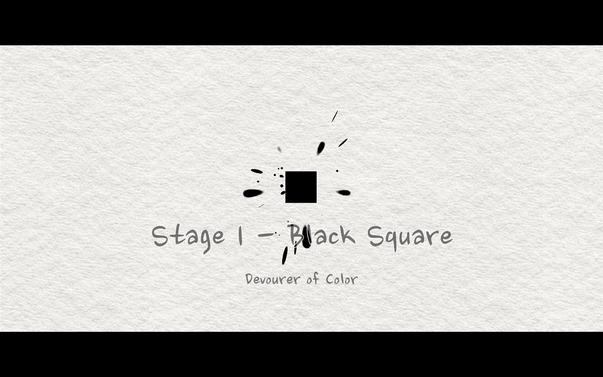
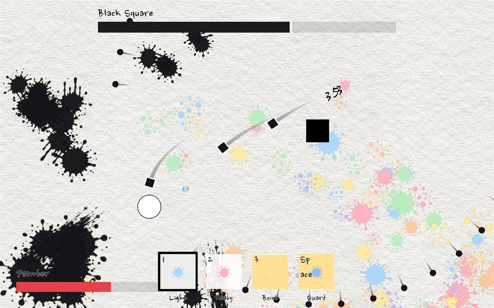
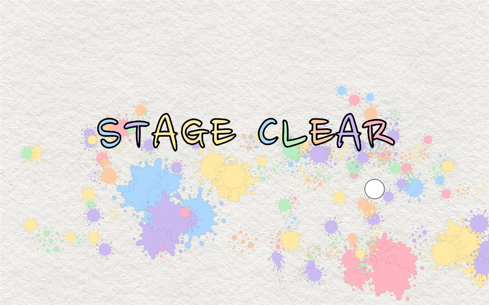

# AutoDraw

파스텔 화가가 검은 잉크 보스와 싸우는 2D 보스전 연출 샘플입니다.
3D 갤러리에서 빈 액자를 고르면 그 액자 속 세계로 들어가 보스와 싸웁니다.
맞은 자리마다 물감 자국이 남고, 보스를 쓰러뜨리면 검은 잉크만 걷혀 남은 그림이 액자에 걸립니다.
보스를 처음 깨면 특성 포인트와 새 스킬을 얻고, 갤러리에서 장비를 바꾸고 특성을 찍어 다음 보스에 도전합니다.

> 🎬 시연 영상: [YouTube](https://youtu.be/nhz6yQkhps4) (첫 번째 보스까지)
>
> 🚧 진행 중인 프로젝트입니다 (2026.10.12 ~). 현재 상태와 다음 할 일은 [아래](#진행-상황)에 정리했습니다.
>
> 📂 코드는 [`develop`](https://github.com/iThing1/AutoDraw/tree/develop) 브랜치에 있습니다. `main`에는 이 문서만 올려 두었습니다.
>
> 📝 문서 작성일: 2026.10.14 · 수정일: 2026.11.06 ([수정 이력](#문서-수정-이력))

| 보스 등장 | 전투 | 스테이지 클리어 |
|---|---|---|
|  |  |  |

| | |
|---|---|
| 장르 | 2D 보스전 (자동 공격 + 직접 이동 · 막기 / 대시) + 3D 1인칭 갤러리 |
| 엔진 | Unity 6000.3.13f1 · URP (2D 렌더러 + 갤러리용 3D 렌더러) |
| 사용 기술 | C# · UniTask · DOTween · Cinemachine 3 · Input System · 구글 시트 → JSON 데이터 표 |
| 인원 | 1인 |

## 실행 방법

1. `develop` 브랜치를 받아 Unity 6000.3.13f1로 엽니다.
2. `Assets/01_Scenes/BattleScene.unity`를 열고 플레이합니다. 타이틀에서 시작해 갤러리로 들어갑니다.

> 타격 이펙트에 쓴 Cartoon FX Remaster Free는 에셋 스토어 라이선스라 저장소에 포함하지 않았습니다.
> 에셋 스토어에서 받아 `Assets/00_ThirdParty/` 아래에 넣으면 이펙트가 보입니다. 없어도 컴파일과 실행은 됩니다.
>
> 장비와 특성은 플레이 중 Unity 메뉴 **AutoDraw → 테스트**에서 바로 얻거나 찍어 볼 수 있습니다.

## 조작

키는 모두 입력 에셋(`InputSystem_Actions`)에 모여 있고, 게임패드도 연결되어 있습니다.

**갤러리**

| 키 | 동작 |
|---|---|
| WASD / 방향키 | 이동 |
| 마우스 | 둘러보기 |
| F | 액자 들어가기 · 장비 보관대 · 특성 이젤 · 팔레트 줍기 |
| Esc | 일시정지 메뉴 |

**보스전**

| 키 | 동작 |
|---|---|
| WASD / 방향키 | 이동 |
| 1 · 2 | 기본 무기 · 화력 무기 선택 (공격은 자동으로 나감) |
| 3 | 특수 스킬 — 게이지가 가득 찼을 때 |
| 4 | 소모품 사용 |
| Space | 유틸리티 — 끼운 것에 따라 막기(게이지를 써서 잠깐 방패) 또는 대시(짧게 미끄러지며 공격을 통과) |
| Esc | 일시정지 메뉴 |

## 흐름

```
타이틀 → 갤러리(1인칭) → 액자 선택 → 접근 → 보스 등장 컷신 → 전투
  ├─ 승리: 처치 슬로모션 → 조각 분해 → 검은 잉크 걷힘 · STAGE CLEAR → 남은 그림을 액자에 걸기
  │         (처음 깨면 특성 포인트 + 스킬 해금)
  └─ 패배: 잉크 자국에서 팔이 나와 끌고 들어감 · INK OVER
→ RETRY(다시 도전) / GALLERY(갤러리로)
```

### 스테이지

네 액자가 각각 보스 하나로 이어집니다. 기믹을 해내면 보스가 잠시 그로기에 빠져 받는 피해가 늘어납니다.

| 스테이지 | 이름 | 체력 | 공격을 알리는 방식 |
|---|---|---|---|
| 1 (북쪽 액자) | Black Square | 2000 | 별도 규칙 없음 |
| 2 (동쪽 액자) | Ink Hands | 2400 | 손동작 (왼손 파랑 = 설치형, 오른손 빨강 = 공격형, 양손 = 큰 패턴) |
| 3 (서쪽 액자) | The Forger (위작가) | 3000 | 회색 연필 밑그림이 먼저 그려지고, 그 자리에 잉크가 내려앉음 |
| 4 (남쪽 액자) | The Curator (큐레이터) | 3600 | 전시장 조명이 먼저 바닥을 비추고, 비춘 자리에 공격이 떨어짐 |

- **스테이지 1** — 기본 연사 · 측면 포대 일제사격 · 돌진 베기 · 호밍 미사일 + 환경 탄막(빈틈 링 · 회전 나선)
- **스테이지 2** — 페이즈가 있는 첫 보스입니다. 환경 탄막에 바둑판이 더해집니다.
  - 1페이즈: 흩뿌리기 · 붓 휘두르기 · 먹물 낙하 · 먹선 긋기 · 잉크 잠수 · 시간 왜곡, 체력 75 / 50 / 25%에서 기믹(먹물 범람 · 구체 되받아치기 · 잉크 팔)
  - 0%에서 쓰러졌다가 검은 빛기둥과 함께 부활 → 2페이즈(체력 80%): 강화 패턴 + 그림자 돌진 · 먹물 소용돌이, 66% 암흑 · 33% 카운터
- **스테이지 3** — 플레이어를 흉내 내고 그림을 위조하는 보스입니다. 환경 탄막에 콜라주가 더해집니다.
  - 1페이즈: 흉내 사격 · 휘갈기기 · 물감 훔치기 · 데칼코마니 · 액자 가두기 · 해칭, 66% 원본 찾기 · 33% 따라 그리기 시험
  - 2페이즈(체력 90%): 강화 패턴 + 소실점 · 되감기, 66% 데칼코마니 분신 · 33% 꼭두각시
  - 막기나 대시를 10번 쓰면 받아치는 패턴(반사 방패 · 바람)이 나옵니다.
- **스테이지 4** — 갤러리의 주인인 최종 보스로, 앞선 보스들을 소장품처럼 꺼내 씁니다. 환경 탄막에 보안 레이저가 더해집니다.
  - 1페이즈: 명패 던지기 · 스포트라이트 · 법봉 · 전시 · 감시 카메라 · 소장품 라벨, 75% 관람 안내 · 50% 관람권 · 25% 소장 목록
  - 2페이즈(체력 90%): 강화 패턴 + 폐관 시간 · 관람 동선, 50% 마지막 전시
  - 막기를 10번 쓰면 "손대지 마세요", 대시를 10번 쓰면 "뛰지 마세요" 패턴이 나옵니다.
  - **빨간 예고는 막을 수 없다**는 규칙을 둡니다. 대시로 피하거나 자리를 벗어나야 합니다.

## 성장

갤러리에 장비 보관대, 특성 이젤, 숨겨진 팔레트가 있습니다.

| 칸 | 고를 수 있는 것 |
|---|---|
| 기본 무기 | Light Brush (처음 장비) · Paint Orbs |
| 화력 무기 | Wide Brush (처음 장비) · Roller |
| 스킬 | Paint Bomb (처음 장비) · Black Square (스테이지 1 첫 클리어) · Ink Hands (스테이지 2 첫 클리어) · Clone (스테이지 3 첫 클리어) |
| 유틸리티 | 막기 (처음 장비) · 대시 |
| 소모품 | Paint (회복) · Remover (주변 잉크 지우기) |

- **특성 트리** — 세 갈래 24칸입니다. 몸과 공격(체력 · 이동 속도 · 무기 피해), 도구(물감 구슬 · 롤러 · 소모품 해금과 횟수), 막기와 대시(방패 성능 · 대시 해금과 거리)로 나뉘고, 앞 칸을 찍어야 다음 칸이 열립니다.
- **특성 포인트** — 스테이지를 처음 깰 때 얻습니다 (스테이지 1부터 차례로 1 · 2 · 3 · 4점).
- **팔레트** — 갤러리 곳곳에 숨어 있고, 하나를 쓰면 찍은 특성을 한 번 되돌려 다시 찍을 수 있습니다.
- 특성으로 얻은 장비는 따로 저장하지 않고 찍은 특성에서 다시 만들어, 특성을 되돌리면 함께 빠집니다.

## 구조

- 씬은 하나입니다. **GameManager**가 `UIManager` · `PoolManager` · `TimeScaleManager` · `SoundManager` · `SettingsManager` · `FeedbackManager` · `CinematicDirector` · `DataTableManager` · `AssetManager`를 일반 클래스로 들고 있습니다.
- **MapSpawner**가 타이틀을 띄우고, 갤러리와 전투 스테이지를 오가며 생성 · 파괴하고, 클리어 그림을 저장합니다.
- **BattleStage**(스테이지 프리팹)가 전투 흐름을 UniTask로 순서대로 진행합니다.
- **유닛**은 컴포넌트 조합입니다: `BattleUnit`(상태) · `Health` · `AutoAttacker` · `UnitMover` · `PlayerGuard` · `PlayerDash` · `PlayerConsumable`. 페이즈가 있는 보스는 `BossPhaseMachine`을 더 붙이고, 손이 있는 보스는 `BossHands`도 붙입니다.
- **플레이어 데이터**(`PlayerModel`)는 스탯 · 장비 · 진행 기록(깬 스테이지 · 포인트 · 찍은 특성 · 주운 팔레트)을 들고, 전투에 들어갈 때 `PlayerSetup`이 장비를 유닛에 넘깁니다. 진행과 설정은 JSON 파일로 저장합니다.
- **수치 데이터는 두 갈래**입니다. 장비 · 스킬 · 소모품 · 특성 · 플레이어 스탯처럼 표로 다루기 좋은 값은 구글 시트에서 JSON으로 가져오고, 연출 · 패턴 수치는 ScriptableObject에 둡니다. ScriptableObject는 캐싱하지 않고 매번 읽어 플레이 중 조정이 바로 반영됩니다.

```
Assets/02_Scripts
├─ Battle
│  ├─ AttackStyles   공격 방식 (전략 패턴) — Projectile · Melee · Area · Reaction · Summon
│  ├─ Boss           페이즈 진행, 손 예고
│  │  └─ Gimmicks    체력 구간 기믹
│  ├─ Combat         조준 · 명중 판정 · 피해 처리 · 탄 움직임
│  ├─ Consumables    소모품 효과
│  ├─ Cutscenes      보스 등장 · 엔딩 · 패배 · 부활
│  ├─ Hazards        보스와 따로 도는 환경 탄막
│  ├─ Movement       배회 · 추격 · 직접 이동
│  ├─ Paint          물감 자국 캔버스 · 텍스처 굽기
│  ├─ Player         막기 · 대시 · 공격 · 소모품 입력
│  └─ Units          유닛 상태 · 체력
├─ Camera       전투 · 시네마틱 카메라
├─ Common       연출 공통(Effects), 유틸(Utilities)
├─ Data         ScriptableObject · 설정 클래스 · 데이터 표 행 · 저장 데이터
├─ Editor       구글 시트 가져오기 도구 · 테스트 메뉴
├─ Enums
├─ Gallery      갤러리 방 · 1인칭 이동 · 액자 · 장비 보관대 · 이젤 · 팔레트
├─ Manager
├─ Model        플레이어 스탯 · 장비 · 진행 기록 · 특성
└─ UI           MVVM (Base · ViewModels · Views)
```

## 설계 포인트

- **공격 = 전략 패턴** — `AttackStyle` 추상 SO를 상속해 패턴을 추가합니다. 공격 방식 36종이 모두 클래스 하나씩이고, 새 방식을 넣을 때 기존 코드는 그대로입니다.
- **유닛 행동 = 상태 패턴** — `UnitState`(Idle / Move / Action / Dead). 이동과 공격 패턴이 동시에 위치를 움직이지 않습니다.
- **페이즈와 기믹은 데이터** — `BossPhaseData`에 페이즈 체력 비율 · 패턴 묶음 · "체력 n%에서 이 기믹"을 적습니다. `BossPhaseMachine`은 데이터를 읽어 진행만 하고, 기믹 13종은 `BossGimmick`을 상속한 클래스 하나씩입니다. 실패에 큰 피해가 따르는 기믹은 `PunishingBossGimmick`을 상속합니다.
- **명중 판정은 한 곳** — `AttackTarget`이 조준 · 명중 반경 · 막기 · 대시 회피 · 근접 접근 지점 · 예측 사격을 맡고, `DamageDealer`가 피해 계산과 적용을 맡습니다. 공격 패턴은 판정을 모릅니다. 바닥 영역은 몸에 닿으면 맞고, 안전한 원은 몸 전체가 들어가야 안전하다는 기준도 여기서 정합니다.
- **시간 배율은 한 곳** — `TimeScaleManager`만 `Time.timeScale`을 바꿉니다. 슬로모션과 막기는 `using` 블록으로 걸고 풀어 해제 누락이 없습니다. 보스만 빼고 느려지는 시간 왜곡 구역은 `SlowZone`이 스스로 맡습니다.
- **데이터 표 = 구글 시트** — 표 이름 = 클래스 이름 = 시트 탭 이름 = JSON 파일 이름으로 맞춰, 표를 늘릴 때 연결 코드를 따로 쓰지 않습니다. 가져오기 도구는 값 종류 · 에셋 키 · 특성 트리 연결 · 스테이지 보상 스킬을 검사하고, 오류가 하나라도 있으면 어떤 파일도 바꾸지 않아 표끼리 어긋나지 않습니다.
- **에셋은 키로** — 표에는 프리팹 대신 `AttackStyle/Light` 같은 키를 적고 `AssetRegistry`가 실제 에셋을 찾아 줍니다. 나중에 어드레서블로 옮겨도 키는 그대로 둡니다.
- **UI = MVVM** — 전투 HUD · 장비 화면 · 특성 트리가 ViewModel과 View로 나뉩니다. View는 값을 그리기만 하고, 장비 칸마다 끼울 수 있는 조건은 규칙 클래스(`WeaponLoadoutRule` 등)가 맡습니다.
- **풀링과 미리 생성** — 투사체 · 이펙트를 재사용하고, 패턴 전용 프리팹은 전투 전에 만들어 둡니다.
- **물감 자국 굽기** — 자국을 텍스처 두 장에 구워 개수 상한 없이 남깁니다. 아래 장에는 플레이어 물감만, 위 장에는 잉크와 물감을 찍힌 순서대로 그려, 위 장만 흐리면 물감은 남기고 잉크만 지울 수 있습니다. 판정은 텍스처를 읽지 않고 자국 기록으로 합니다.
- **클리어 그림 저장** — 엔딩에서 잉크가 걷힌 종이를 전투 카메라로 촬영해 PNG로 저장하고, 갤러리 액자가 불러와 겁니다.

## 문제와 해결

| 문제 | 원인 | 해결 |
|---|---|---|
| 보스 패턴을 추가할 때마다 기존 코드를 고쳐야 함 | 발사 방식을 enum + switch로 분기 | 추상 SO + 하위 클래스로 분리 ([d41cfc9](https://github.com/iThing1/AutoDraw/commit/d41cfc9)) |
| 패턴 도중 보스가 다시 배회함 | 멈춤을 bool 하나로 관리해 겹치면 먼저 끝난 쪽이 해제 | 유닛 상태(UnitState) 도입 ([ac0ad23](https://github.com/iThing1/AutoDraw/commit/ac0ad23)) |
| 돌진 베기 중 보스가 쓰러지면 엔딩 슬로모션이 풀림 | 늦게 끝난 쪽이 남이 건 슬로모션까지 해제 | 번호표 + `using` 블록으로 건 쪽만 해제 ([0684a3f](https://github.com/iThing1/AutoDraw/commit/0684a3f)) |
| 빠른 탄이 플레이어를 뚫고 지나감 | 한 프레임 이동량이 몸보다 커서 위치 점검 사이를 건너뜀 | 지나온 선분에서 가장 가까운 점으로 판정 ([538f302](https://github.com/iThing1/AutoDraw/commit/538f302)) |
| 물감 자국이 끝없이 쌓여 무거워짐 | 자국 하나가 스프라이트 하나라 패턴이 늘수록 개수와 그리기 비용이 커짐 | 텍스처 두 장에 구워 상한 없이 남기고, 잉크만 위 장에서 지움 ([d57fcb4](https://github.com/iThing1/AutoDraw/commit/d57fcb4)) |
| 트윈을 끊을 때 DOTween 오류가 남 | 트윈을 지우는 도중에 기다리던 코드가 이어져, 그 정리 코드가 같은 대상을 다시 DOKill함 | 기다림을 먼저 끊고 트윈은 그 뒤에 죽이는 확장 메서드로 통일 ([a0dec07](https://github.com/iThing1/AutoDraw/commit/a0dec07)) |
| 복제 스킬이 끝나기 전에 또 쓰면 복제체가 쌓임 | 게이지가 차면 같은 스킬이 아직 도는 중이어도 다시 발동됨 | 도는 중인 스킬을 기억해, 끝나야 다시 쓸 수 있게 함 ([7e72cdc](https://github.com/iThing1/AutoDraw/commit/7e72cdc)) |
| 패턴마다 맞는 기준이 달라 피한 것 같은데 맞거나 그 반대가 생김 | 몸 중심으로 재는 패턴과 몸 크기로 재는 패턴이 섞임 | 판정을 `AttackTarget`의 기준으로 통일 ([c96bcab](https://github.com/iThing1/AutoDraw/commit/c96bcab)) |

## 진행 상황

- [x] 전투 흐름과 갤러리 (보스 등장 · 엔딩 · 패배 · 다시 도전 · 클리어 그림 걸기)
- [x] 타이틀 · 설정 · 일시정지 · 진행 저장
- [x] 보스 3마리 (환경 탄막 · 페이즈 · 기믹 9종 · 부활 연출 · 첫 클리어 보상 스킬)
- [x] 네 번째 보스 패턴과 기믹 (페이즈 2개 · 기믹 4종 · 보안 레이저)
- [x] 플레이어 조작 (자동 공격 · 이동 · 막기 · 대시 · 소모품)
- [x] 성장 (장비 화면 · 특성 트리 · 첫 클리어 보상 · 팔레트)
- [x] 데이터 표 · HUD MVVM · 물감 자국 굽기 · 그림과 애니메이션 · BGM
- [ ] 네 번째 보스 마무리 (전용 그림 · 첫 클리어 보상 스킬)
- [ ] 전체 클리어 엔딩
- [ ] 무기 · 스킬 수치를 데이터 표로 이관, 장비 화면 스펙 표시, 기믹 파훼 보상 (작업 중)
- [ ] Clone 스킬 전용 아이콘
- [ ] 잉크가 녹아 사라지는 셰이더
- [ ] 시연 영상 · 스크린샷 갱신 (지금은 첫 번째 보스까지)

## 리소스

| 리소스 | 출처 | 라이선스 |
|---|---|---|
| 타격 이펙트 | Cartoon FX Remaster Free (Jean Moreno) | Unity Asset Store EULA (저장소 미포함) |
| 효과음 | Kenney — Impact · Interface · Sci-fi Sounds | CC0 |
| BGM | Suno로 생성 (갤러리 · 보스전) | Suno 무료 플랜 (비상업) |
| 글꼴 | 나눔손글씨 붓 (NAVER) | SIL OFL 1.1 |
| 라이브러리 | UniTask (Cysharp) · DOTween (Demigiant) | MIT · DOTween 무료 라이선스 |

## 문서 수정 이력

| 날짜 | 수정 내용 | 이유 |
|---|---|---|
| 2026.11.06 | 스테이지 설명을 보스 4마리 기준으로 다시 쓰고, 보스별 체력 · 예고 방식 표 추가 | 문서가 보스 2마리에 멈춰 있고 남쪽 · 서쪽 액자를 잠겼다고 적고 있었는데, 지금은 네 액자 모두 보스로 이어짐 |
| 2026.11.06 | 진행 상황 갱신: 세 번째 보스 · 네 번째 보스 패턴과 기믹 · 타이틀 · 저장을 완료로, 남은 일을 네 번째 보스 마무리 · 엔딩 · 수치 이관 · 시연 영상 갱신 등으로 정리 | 세 번째 보스를 "작업 중"으로 적은 뒤 develop에 병합되었고, 게임 완성까지 남은 일이 달라짐. 영상과 스크린샷은 아직 첫 번째 보스까지만 담고 있음 |
| 2026.11.06 | 성장 수치 수정: Clone 스킬 추가, 특성 23칸 → 24칸, 스테이지 3 · 4 포인트 추가 | 세 번째 보스 보상과 특성이 늘었는데 문서에 없었음 |
| 2026.11.06 | 구조 수정: `BattleManager` → `BattleStage`, GameManager가 드는 매니저 목록, 타이틀 시작, 공격 폴더 Reaction · Summon 추가 | 리팩터링으로 이름과 구성이 바뀌어 문서의 이름으로는 코드를 찾을 수 없었음 |
| 2026.11.06 | 설계 포인트 수정: 공격 방식 15종 → 36종, 기믹 13종과 실패 기믹 부모 클래스, 피격 판정 기준 추가 | 숫자가 오래되었고, 판정 통일이 1~3보스까지 영향을 주는 설계 변경이라 남겨 둘 필요가 있음 |
| 2026.11.06 | 문제와 해결에 복제 스킬 겹침 · 피격 판정 통일 추가 | 세 번째 · 네 번째 보스 작업에서 나온 문제 중 원인과 해결이 분명한 것을 기록 |
| 2026.11.06 | 이 수정 이력 항목 추가 | 언제 왜 고쳤는지 문서만 보고 알 수 있게 하려는 요청 |
| 2026.10.26 | 장비 · 특성 · 데이터 표 반영, 성장 항목 추가 | develop에 들어간 내용 기준으로 문서 전체를 맞춤 |
| 2026.10.18 | 두 번째 보스, 구조 · 설계 포인트 · 문제와 해결 보강 | 두 번째 보스 작업 내용을 반영 |
| 2026.10.14 | 문서 작성, 시연 영상 링크 · 작성일 · 스크린샷 추가 | 프로젝트 소개와 실행 방법을 처음 정리 |
