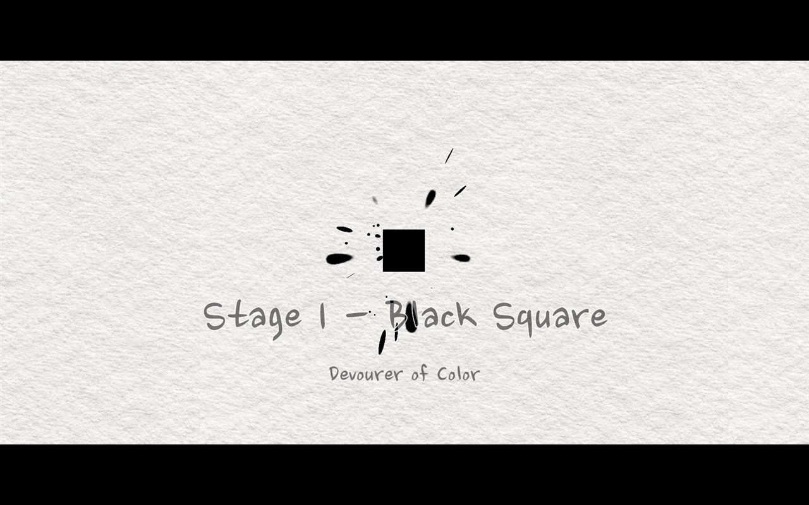
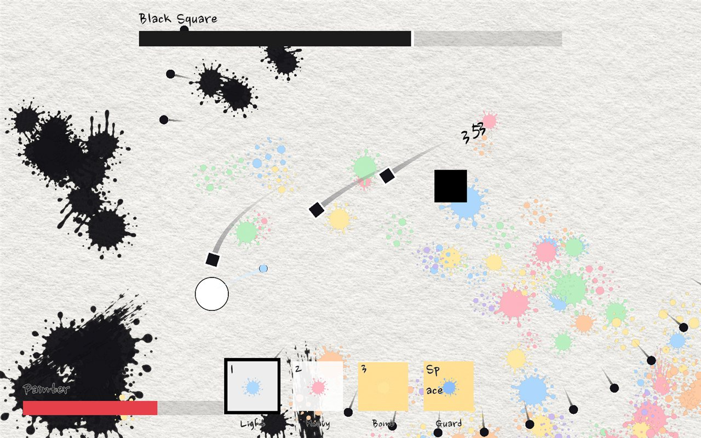
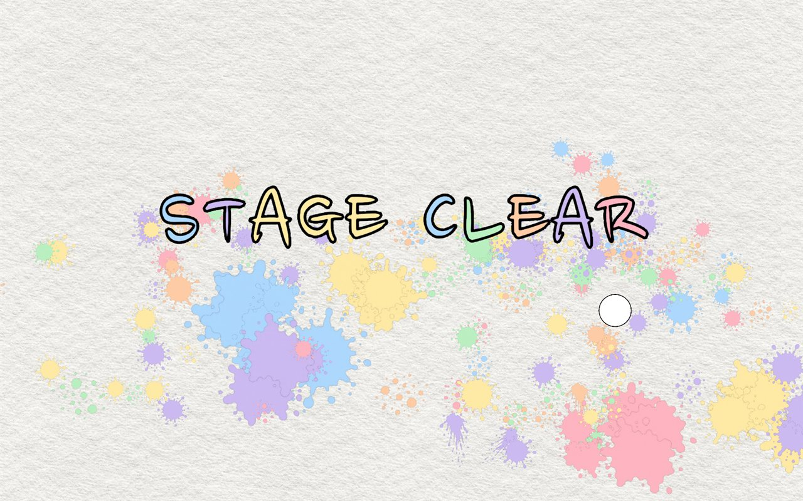

# AutoDraw

파스텔 화가가 검은 잉크 보스와 싸우는 2D 보스전 연출 샘플입니다.
3D 갤러리에서 빈 액자를 고르면 그 액자 속 세계로 들어가 보스와 싸웁니다.
맞은 자리마다 물감 자국이 남고, 보스를 쓰러뜨리면 검은 잉크만 걷혀 남은 그림이 액자에 걸립니다.

> 🎬 시연 영상: [YouTube](https://youtu.be/nhz6yQkhps4) (첫 번째 보스까지)
>
> 🚧 진행 중인 프로젝트입니다 (2026.10.12 ~). 현재 상태와 다음 할 일은 [아래](#진행-상황)에 정리했습니다.
>
> 📂 코드는 [`develop`](https://github.com/iThing1/AutoDraw/tree/develop) 브랜치에 있습니다. `main`에는 이 문서만 올려 두었습니다.
>
> 📝 문서 작성일: 2026.10.14 · 수정일: 2026.10.18

| 보스 등장 | 전투 | 스테이지 클리어 |
|---|---|---|
|  |  |  |

| | |
|---|---|
| 장르 | 2D 보스전 (자동 공격 + 직접 이동 · 막기) + 3D 1인칭 갤러리 |
| 엔진 | Unity 6000.3.13f1 · URP (2D 렌더러 + 갤러리용 3D 렌더러) |
| 사용 기술 | C# · UniTask · DOTween · Cinemachine 3 · Input System |
| 인원 | 1인 |

## 실행 방법

1. `develop` 브랜치를 받아 Unity 6000.3.13f1로 엽니다.
2. `Assets/01_Scenes/BattleScene.unity`를 열고 플레이합니다. 갤러리에서 시작합니다.

> 타격 이펙트에 쓴 Cartoon FX Remaster Free는 에셋 스토어 라이선스라 저장소에 포함하지 않았습니다.
> 에셋 스토어에서 받아 `Assets/00_ThirdParty/` 아래에 넣으면 이펙트가 보입니다. 없어도 컴파일과 실행은 됩니다.

## 조작

키는 모두 입력 에셋(`InputSystem_Actions`)에 모여 있고, 게임패드도 연결되어 있습니다.

**갤러리**

| 키 | 동작 |
|---|---|
| WASD / 방향키 | 이동 |
| 마우스 | 둘러보기 |
| F | 액자 앞에서 들어가기 |
| Esc | 일시정지 메뉴 |

**보스전**

| 키 | 동작 |
|---|---|
| WASD / 방향키 | 이동 |
| 1 · 2 | 기본 공격 선택 (공격은 자동으로 나감) |
| 3 | 특수 스킬 — 게이지가 가득 찼을 때 |
| Space | 막기 — 게이지 20을 써서 0.25초 동안 방패 |

## 흐름

```
갤러리(1인칭) → 액자 선택 → 접근 → 보스 등장 컷신 → 전투
  ├─ 승리: 처치 슬로모션 → 조각 분해 → 검은 잉크 걷힘 · STAGE CLEAR → 남은 그림을 액자에 걸기
  └─ 패배: 잉크 자국에서 팔이 나와 끌고 들어감 · INK OVER
→ RETRY(다시 도전) / GALLERY(갤러리로)
```

- **스테이지 1 (북쪽 액자)** — 기본 연사 · 측면 포대 일제사격 · 돌진 베기 · 호밍 미사일 + 환경 탄막(빈틈 링 · 회전 나선)
- **스테이지 2 (동쪽 액자)** — 페이즈가 있는 보스
  - 1페이즈: 짤패 6종(흩뿌리기 · 붓 휘두르기 · 먹물 낙하 · 먹선 긋기 · 잉크 잠수 · 시간 왜곡) + 체력 75 / 50 / 25%에서 기믹(먹물 범람 · 구체 되받아치기 · 잉크 팔)
  - 0%에서 쓰러졌다가 검은 빛기둥과 함께 부활 → 2페이즈(체력 80%): 강화 패턴 + 그림자 돌진 · 먹물 소용돌이, 66% 암흑 · 33% 카운터
  - 손동작으로 다음 공격을 예고합니다 (왼손 파랑 = 설치형, 오른손 빨강 = 공격형, 양손 = 큰 패턴). 기믹을 하나 넘길 때마다 보스가 한 단계씩 검어집니다.
- 남쪽 · 서쪽 액자는 천으로 덮인 잠긴 액자입니다.

## 구조

- 씬은 하나입니다. **GameManager**가 `UIManager` · `PoolManager` · `TimeScaleManager` · `SoundManager` · `SlowZoneManager`를 일반 클래스로 들고 있습니다.
- **MapSpawner**가 갤러리와 전투 스테이지를 오가며 생성 · 파괴하고, 클리어 그림을 저장합니다.
- **BattleManager**(스테이지 프리팹)가 전투 흐름을 UniTask로 순서대로 진행합니다.
- **유닛**은 컴포넌트 조합입니다: `BattleUnit`(상태) · `Health` · `AutoAttacker` · `UnitMover` · `PlayerGuard`. 페이즈가 있는 보스는 `BossPhaseMachine` · `BossHands`를 더 붙입니다.
- **연출 · 패턴 수치는 전부 ScriptableObject**입니다. 캐싱하지 않고 매번 읽어 플레이 중 조정이 바로 반영됩니다.

```
Assets/02_Scripts
├─ Battle
│  ├─ AttackStyles   공격 방식 (전략 패턴) — Projectile · Melee · Area
│  ├─ Boss           페이즈 진행, 손 예고
│  │  └─ Gimmicks    체력 구간 기믹
│  ├─ Combat         조준 · 명중 판정 · 피해 처리
│  ├─ Cutscenes      보스 등장 · 엔딩 · 패배 · 부활
│  ├─ Hazards        보스와 따로 도는 환경 탄막
│  ├─ Movement       배회 · 추격 · 직접 이동
│  ├─ Paint          물감 자국 캔버스
│  ├─ Player         막기 · 공격 입력
│  └─ Units          유닛 상태 · 체력
├─ Camera       전투 · 시네마틱 카메라
├─ Common       연출 공통(Effects), 유틸(Utilities)
├─ Data         ScriptableObject와 설정 클래스
├─ Enums
├─ Gallery      갤러리 방 · 1인칭 이동 · 액자
├─ Manager
└─ UI
```

## 설계 포인트

- **공격 = 전략 패턴** — `AttackStyle` 추상 SO를 상속해 패턴을 추가합니다. 공격 방식 14종이 모두 클래스 하나씩이고, 새 방식을 넣을 때 기존 코드는 그대로입니다.
- **유닛 행동 = 상태 패턴** — `UnitState`(Idle / Move / Action / Dead). 이동과 공격 패턴이 동시에 위치를 움직이지 않습니다.
- **페이즈와 기믹은 데이터** — `BossPhaseData`에 페이즈 체력 비율 · 패턴 묶음 · "체력 n%에서 이 기믹"을 적습니다. `BossPhaseMachine`은 데이터를 읽어 진행만 하고, 기믹은 `BossGimmick`을 상속한 클래스 하나씩입니다.
- **명중 판정은 한 곳** — `AttackTarget`이 조준 · 명중 반경 · 막기 · 근접 접근 지점 · 예측 사격을 맡고, `DamageDealer`가 피해 계산과 적용을 맡습니다. 공격 패턴은 판정을 모릅니다.
- **시간 배율은 한 곳** — `TimeScaleManager`만 `Time.timeScale`을 바꿉니다. 슬로모션과 막기는 `using` 블록으로 걸고 풀어 해제 누락이 없습니다. 보스만 빼고 느려지는 시간 왜곡 구역은 `SlowZoneManager`가 따로 맡습니다.
- **풀링과 미리 생성** — 투사체 · 이펙트 · 물감 자국을 재사용하고, 패턴 전용 프리팹은 전투 전에 만들어 둡니다. 물감 자국은 한 장의 스프라이트 시트라 배칭됩니다.
- **클리어 그림 저장** — 엔딩에서 잉크가 걷힌 종이를 전투 카메라로 촬영해 PNG로 저장하고, 갤러리 액자가 불러와 겁니다.

## 문제와 해결

| 문제 | 원인 | 해결 |
|---|---|---|
| 보스 패턴을 추가할 때마다 기존 코드를 고쳐야 함 | 발사 방식을 enum + switch로 분기 | 추상 SO + 하위 클래스로 분리 ([d41cfc9](https://github.com/iThing1/AutoDraw/commit/d41cfc9)) |
| 패턴 묶음끼리 서로를 넣으면 멈춤 | 묶음 안의 묶음을 끝없이 따라감 | 깊이 제한 + 인스펙터에서 즉시 경고 ([343c8b5](https://github.com/iThing1/AutoDraw/commit/343c8b5)) |
| 패턴 도중 보스가 다시 배회함 | 멈춤을 bool 하나로 관리해 겹치면 먼저 끝난 쪽이 해제 | 유닛 상태(UnitState) 도입 ([ac0ad23](https://github.com/iThing1/AutoDraw/commit/ac0ad23)) |
| 돌진 베기 중 보스가 쓰러지면 엔딩 슬로모션이 풀림 | 늦게 끝난 쪽이 남이 건 슬로모션까지 해제 | 번호표 + `using` 블록으로 건 쪽만 해제 ([0684a3f](https://github.com/iThing1/AutoDraw/commit/0684a3f)) |
| 막기 방패를 탄이 그냥 통과함 | 도착 순간에만 판정, 방패 그림과 판정 크기도 다름 | 날아오는 동안 매 프레임 판정, 방패 크기를 판정 반경에서 계산 ([cb28bee](https://github.com/iThing1/AutoDraw/commit/cb28bee)) |
| 빠른 탄이 플레이어를 뚫고 지나감 | 한 프레임 이동량이 몸보다 커서 위치 점검 사이를 건너뜀 | 지나온 선분에서 가장 가까운 점으로 판정, 빗나간 뒤에도 판정 유지 ([538f302](https://github.com/iThing1/AutoDraw/commit/538f302)) |
| 피하는 순간 탄이 홱 꺾임 | 추적 보정이 목표 이동량을 그대로 더함 | 보정 속도를 탄 속도 × 추적 강도로 제한, 빗나간 탄은 이어서 날아감 ([1eb5ef3](https://github.com/iThing1/AutoDraw/commit/1eb5ef3)) |
| 짧은 간격 패턴에서 막기가 아무 반응 없이 안 나감 | 막기 재사용 시간(0.65초)보다 탄 간격이 짧음 | 거절 이유(재사용 · 게이지 부족)를 화면에 보여 주고, 막기 성공 시 재사용 시간 초기화, 패턴 간격 조정 ([99347f8](https://github.com/iThing1/AutoDraw/commit/99347f8)) |
| 2보스전에서 물감 자국이 끝없이 쌓임 | 패턴 수가 늘어 자국 수에 상한이 필요 | 상한 600, 넘으면 보스 잉크부터 흐려지며 지움 — 플레이어 물감은 클리어 그림이라 보호 ([d64470b](https://github.com/iThing1/AutoDraw/commit/d64470b)) |
| 첫 공격 때 프레임이 튐 | 포대 · 칼끝 · 투사체를 처음 쓸 때 생성 | 전투 전 풀에 미리 생성 ([0d8cdd1](https://github.com/iThing1/AutoDraw/commit/0d8cdd1)) |
| 물감 자국이 보스 · 투사체를 덮음 | 자국마다 정렬 순서가 계속 올라감 | 정렬 레이어 분리 (바닥 · 물감 · 유닛 · 투사체 · 이펙트) |

## 진행 상황

- [x] 전투 흐름 (접근 · 보스 등장 · 전투 · 엔딩 · 패배 · 다시 도전)
- [x] 자동 공격과 첫 번째 보스 패턴 (기본 연사 · 측면 포대 일제사격 · 돌진 베기 · 호밍 미사일) + 환경 탄막
- [x] 직접 이동 · 타이밍 막기, 키 입력을 입력 에셋으로 통합
- [x] 갤러리 (1인칭 이동 · 액자 진입 · 클리어 그림 걸기 · 일시정지)
- [x] 두 번째 보스 (페이즈 2개 · 기믹 5종 · 부활 연출)
- [x] BGM (갤러리 · 보스전)
- [ ] 전투 HUD를 MVVM으로 정리 (작업 중)
- [ ] 특성 트리 — 보스를 처음 깨면 포인트, 갤러리 이젤에서 스탯 · 무기 · 소모품 해금
- [ ] 잉크가 녹아 사라지는 셰이더
- [ ] 보스 추가 (총 4마리 예정)

## 리소스

| 리소스 | 출처 | 라이선스 |
|---|---|---|
| 타격 이펙트 | Cartoon FX Remaster Free (Jean Moreno) | Unity Asset Store EULA (저장소 미포함) |
| 효과음 | Kenney — Impact · Interface · Sci-fi Sounds | CC0 |
| BGM | Suno로 생성 (갤러리 · 보스전) | Suno 무료 플랜 (비상업) |
| 글꼴 | 나눔손글씨 붓 (NAVER) | SIL OFL 1.1 |
| 라이브러리 | UniTask (Cysharp) · DOTween (Demigiant) | MIT · DOTween 무료 라이선스 |
